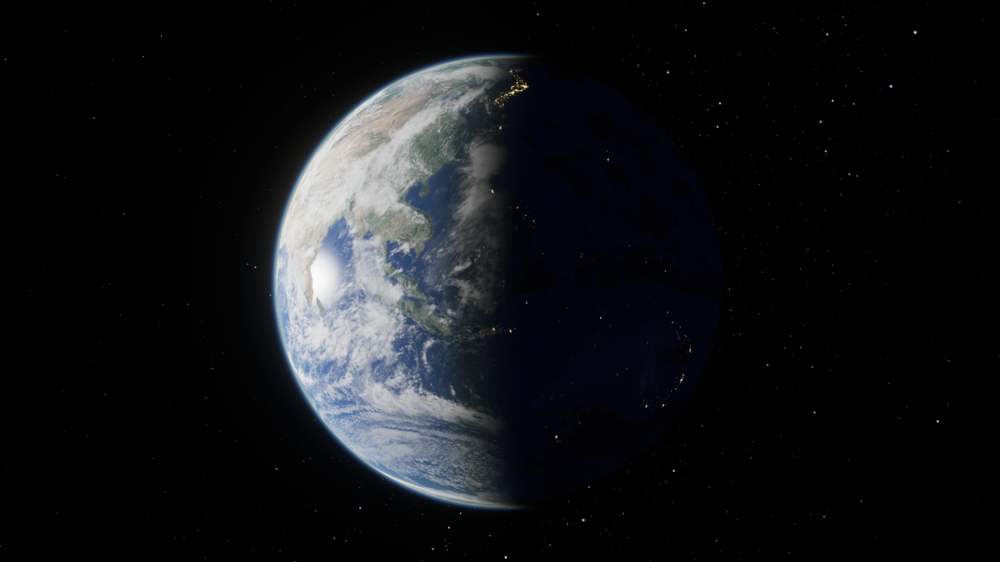
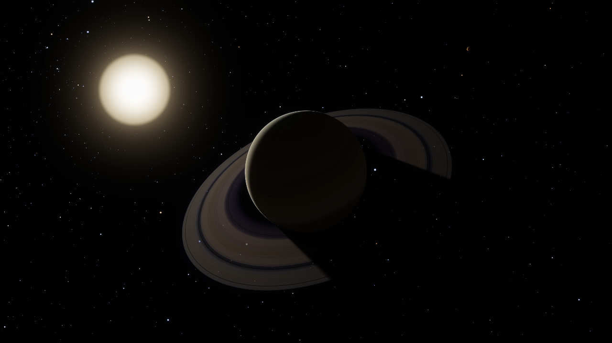
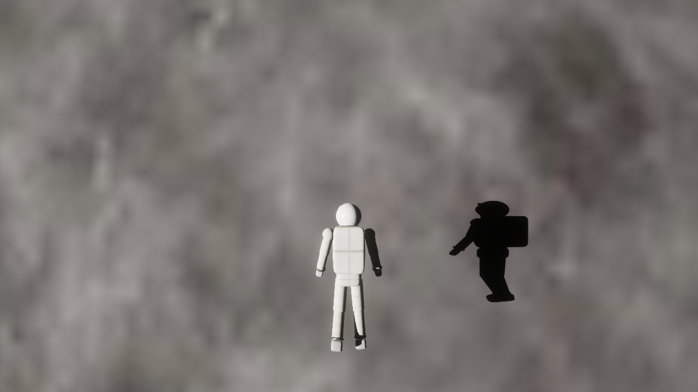
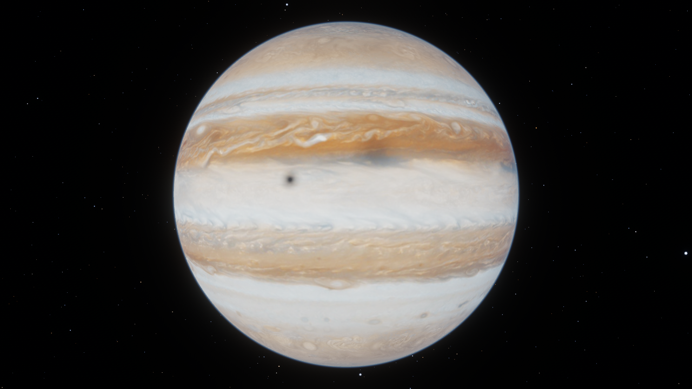
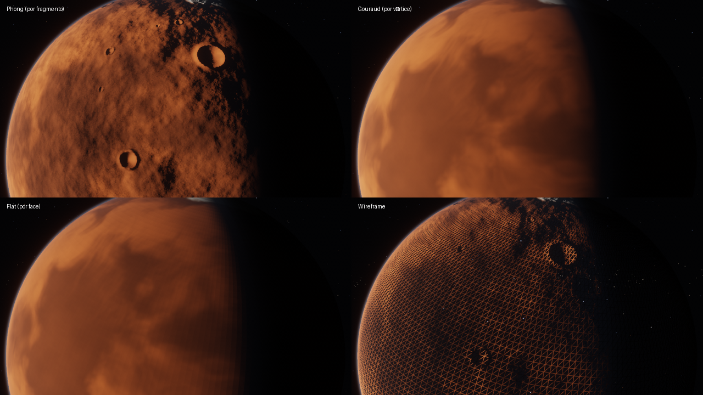
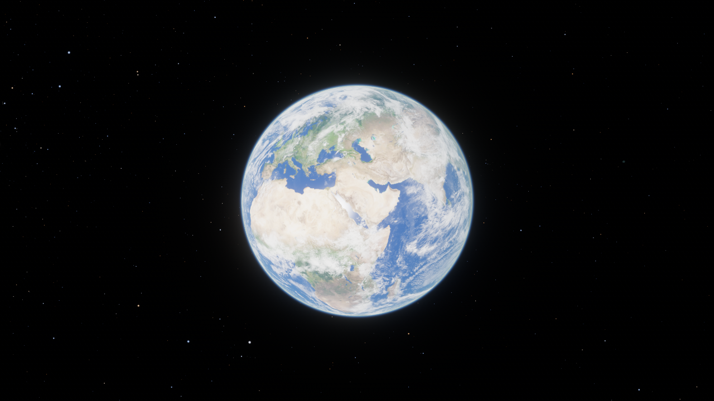
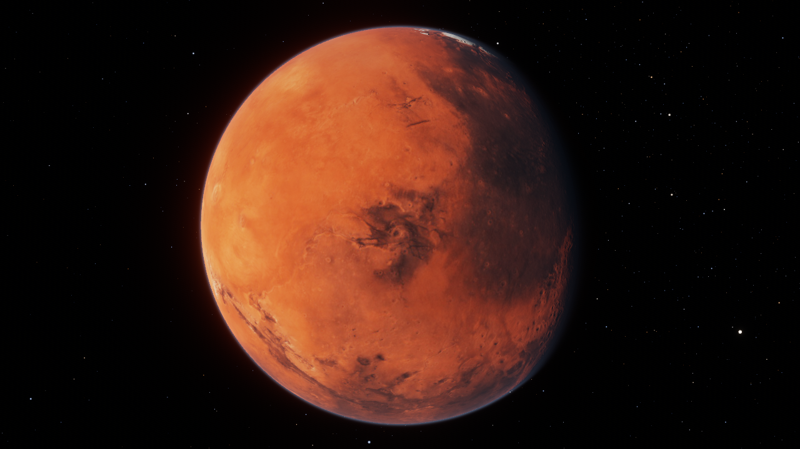
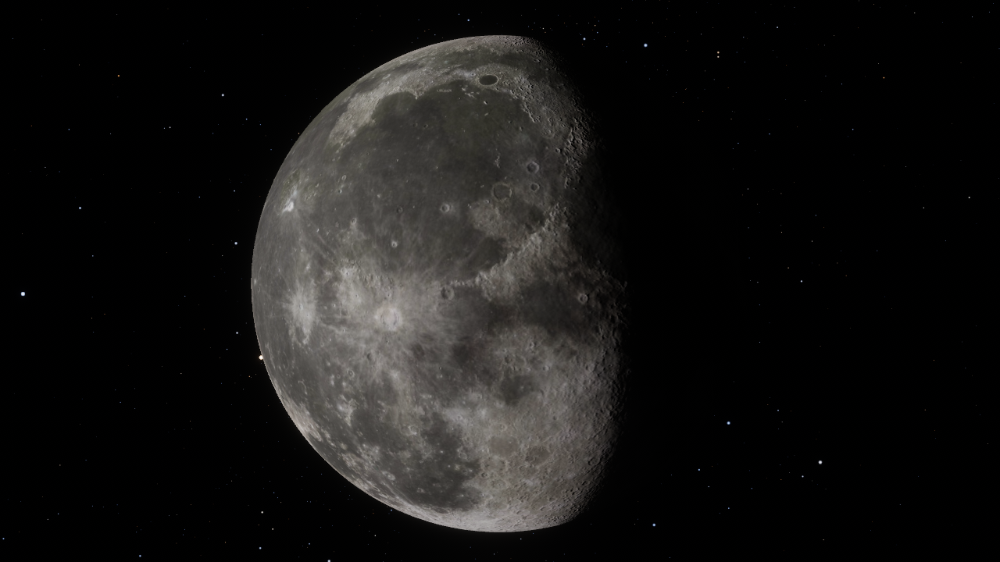
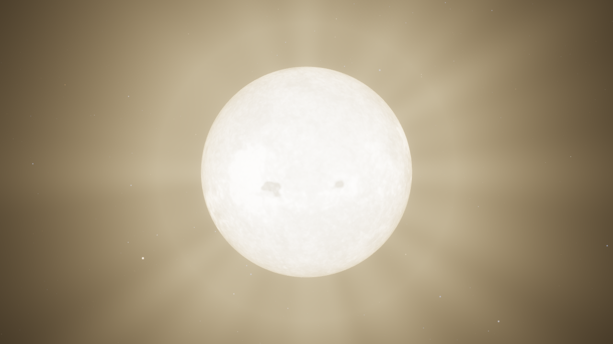

# Astronauta Cósmico — Documentação Técnica de Computação Gráfica

> Projeto da disciplina de Computação Gráfica (UFAL). Aplicação 100% em **OpenGL 3.3 Core Profile**
> (pipeline programável, shaders GLSL 330), escrita em Python com PyOpenGL + GLFW.
> Nenhuma engine ou biblioteca gráfica de alto nível foi usada: toda geometria, textura,
> iluminação, sombra e pós-processamento é feita com chamadas OpenGL e shaders próprios.

| | |
|---|---|
|  |  |
| Terra: terminador, luzes das cidades, nuvens, atmosfera | Saturno em contraluz: sombra do planeta nos anéis |
|  |  |
| Shadow mapping: sombra do astronauta na Lua | Sombra analítica: eclipse de Io sobre Júpiter |

---

## Sumário

1. [Visão geral e tecnologias](#1-visão-geral-e-tecnologias)
2. [Arquitetura e pipeline de renderização](#2-arquitetura-e-pipeline-de-renderização)
3. [Modelagem dos objetos](#3-modelagem-dos-objetos)
4. [Transformações, câmera e precisão numérica](#4-transformações-câmera-e-precisão-numérica)
5. [Iluminação](#5-iluminação)
6. [Sombreamento (shading): Flat, Gouraud e Phong](#6-sombreamento-shading-flat-gouraud-e-phong)
7. [Sombras](#7-sombras)
8. [Texturas](#8-texturas)
9. [Transparência e ordem de desenho](#9-transparência-e-ordem-de-desenho)
10. [HDR, tone mapping, gama e bloom](#10-hdr-tone-mapping-gama-e-bloom)
11. [Simulação: órbitas, rotação e voo](#11-simulação-órbitas-rotação-e-voo)
12. [Desempenho](#12-desempenho)
13. [Perguntas que um professor faria (e respostas)](#13-perguntas-que-um-professor-faria-e-respostas)
14. [Limitações e trabalhos futuros](#14-limitações-e-trabalhos-futuros)
15. [Referências](#15-referências)

---

## 1. Visão geral e tecnologias

O jogador controla um astronauta com superpoderes que voa livremente pelo Sistema Solar. Há
**15 corpos celestes** (Sol, 8 planetas, Lua, Io, Europa, Ganimedes, Calisto e Titã), os anéis de
Saturno, um cinturão com **3.000 asteroides** e um céu com **9.000 estrelas** e a Via Láctea.

| Componente | Uso |
|---|---|
| **OpenGL 3.3 Core** (PyOpenGL) | Toda a renderização: VAO/VBO/EBO, FBOs, texturas, shaders |
| **GLSL 330** | 23 arquivos de shader (vértice/fragmento) + 2 arquivos de inclusão (`common.glsl`, `lighting.glsl`) |
| **GLFW** | Janela, contexto OpenGL, teclado e mouse |
| **NumPy** | Álgebra linear (matrizes, quatérnios) e geração procedural de texturas |
| **Pillow** | Apenas leitura/escrita de imagens e rasterização das letras do HUD |

**Não** se usa o pipeline fixo (`glBegin`, `glLight`, `glMaterial`, `gluPerspective`...): todas as
matrizes são calculadas na CPU e enviadas como *uniforms*, e toda iluminação é calculada nos shaders.

---

## 2. Arquitetura e pipeline de renderização

```
main.py ─► App (astro/app.py)
            ├─ SolarSystem   (astro/solar_system.py)  dados reais + órbitas
            ├─ Astronaut     (astro/astronaut.py)     grafo de cena + animação + voo
            ├─ Mesh          (astro/mesh.py)          geradores de malha
            ├─ TextureStore  (astro/assets.py + procedural.py)
            ├─ Shader        (astro/shader.py)        GLSL com #include
            └─ TextRenderer  (astro/hud.py)
```

**Um quadro** (`App.update` + `App.render`):

```
1. SIMULAÇÃO   órbitas/rotações → astronauta (entrada, colisão) → câmera → exposição
2. SHADOW PASS FBO só-profundidade 2048²: astronauta visto do Sol (projeção ortográfica)
3. PASSO HDR   FBO RGBA16F + MSAA 4x + profundidade float32
     a) céu (Via Láctea, triângulo de tela cheia) + estrelas (GL_POINTS)  [sem z-buffer]
     b) Sol (emissivo)                                                     [opacos]
     c) planetas e luas (planet.frag)
     d) cinturão de asteroides (1 draw call por forma, instancing)
     e) astronauta (31 partes hierárquicas)
     f) linhas das órbitas                                                 [transparentes]
     g) nuvens, atmosferas, anéis — ordenados de trás para frente
     h) halo/coroa do Sol (billboard aditivo)
4. PÓS         resolve MSAA → bloom (6 níveis de mip) → exposição → ACES → sRGB → dithering
5. HUD         texto 2D (atlas de glifos) em LDR → blit para a tela
```

---

## 3. Modelagem dos objetos

Toda geometria é **gerada proceduralmente** em `astro/mesh.py` (nenhum arquivo .obj). O layout de
vértice é intercalado com 11 floats: posição (3), normal (3), UV (2) e tangente (3).

### 3.1 Esfera UV (planetas, luas, Sol, nuvens, atmosferas)

Parametrização por longitude φ e latitude λ:

```
P(u, v) = ( cos λ · sin φ ,  sin λ ,  cos λ · cos φ )      φ = 2πu − π ,  λ = π(v − ½)
N = P   (esfera unitária: a normal é a própria posição)
T = ∂P/∂u normalizada = ( cos φ , 0 , −sin φ )             (tangente, aponta para o leste)
B = N × T                                                   (bitangente, aponta para o norte)
```

* Resolução dos planetas: **256 × 128 segmentos = 33.153 vértices e 65.536 triângulos.**
* Por que esfera UV e não icosfera? Porque as texturas planetárias são **equiretangulares**
  (largura = 2 × altura, linha = latitude, coluna = longitude) — a esfera UV mapeia esse formato
  diretamente: `uv` do vértice = (longitude, latitude).
* A **costura** em φ = ±180° tem vértices duplicados (u = 0 e u = 1 na mesma posição) para que a
  interpolação de UV não "volte" pela textura inteira.
* Nos **polos** os triângulos degeneram e a textura fica comprimida; por isso as texturas
  procedurais são geradas amostrando ruído na **posição 3D** do ponto da esfera (não em u,v),
  o que elimina costura e artefatos polares na própria imagem.

### 3.2 Astronauta — modelagem hierárquica (grafo de cena)

O astronauta é composto de **31 partes** feitas com 4 primitivas paramétricas:

| Primitiva | Equação | Partes |
|---|---|---|
| Esfera (escalada → elipsoide) | acima | capacete, viseira, ombreiras, luzes |
| **Superelipsoide** | `x = a·c(v)^e1·s(u)^e2 , y = b·s(v)^e1 , z = c·c(v)^e1·c(u)^e2` com potências com sinal | tronco, pélvis, mochila (PLSS), luvas, botas, anel do pescoço |
| Cápsula | cilindro + 2 hemisférios | braços, antebraços, coxas, canelas |

O superelipsoide com expoentes e < 1 gera "caixas arredondadas"; suas **normais são analíticas**:
`n = (c(v)^(2−e1)·s(u)^(2−e2)/a , s(v)^(2−e1)/b , c(v)^(2−e1)·c(u)^(2−e2)/c)`.

A hierarquia (`build_parts`) segue a anatomia:

```
pélvis (raiz) ─┬─ tronco ─┬─ mochila, caixa de controle, LED
               │          ├─ pescoço ── capacete ── viseira, lanternas
               │          └─ ombro(E/D) ── braço ── cotovelo ── antebraço ── pulso ── luva
               └─ quadril(E/D) ── coxa ── joelho ── canela ── tornozelo ── bota
```

A matriz de cada parte é o **produto das matrizes locais da raiz até ela**:

```
M_luva = M_mundo · R_voo · T_tronco·R_cintura · T_ombro·R_z(abdução)·R_x(elevação) · T_cotovelo·R_x(flexão) · T_pulso · T_luva
```

Girar o ombro, portanto, move automaticamente cotovelo, antebraço e luva. A ordem é sempre
`T · R · S` (escala primeiro, depois rotação, depois translação, lendo da direita para a esquerda).

**Animação procedural:** existem duas poses-chave (`IDLE` flutuando e `FLY` "pose de super-herói",
com um braço estendido à frente). A pose final é uma **interpolação linear dos ângulos das
articulações** com peso proporcional à velocidade para frente, somada a pequenas oscilações senoidais
(respiração, pernas balançando).

### 3.3 Asteroides — icosfera deformada + *instancing*

Uma icosfera (subdivisão 3 = 642 vértices) tem cada vértice deslocado radialmente por ruído fBm,
gerando 3 formas de rocha. Cada forma é desenhada **1.000 vezes com uma única chamada**
`glDrawElementsInstanced`. Os atributos por instância (raio orbital, ângulo inicial, altura, escala,
eixo e velocidade de rotação, velocidade angular orbital) ficam num VBO com
`glVertexAttribDivisor(loc, 1)`; o **vertex shader** calcula a órbita kepleriana e a rotação
(fórmula de Rodrigues) a partir do tempo — a CPU não toca nos asteroides depois da criação.

### 3.4 Anéis de Saturno

Um **anel (annulus)** plano no plano equatorial de Saturno, de 1,11 a 2,27 raios do planeta, com
`u` = raio normalizado. A textura 1D define cor e **opacidade** de cada região real: anel C (fino),
anel B (denso), **divisão de Cassini**, anel A e **divisão de Encke**.

### 3.5 Escala

| Grandeza | Na cena | Observação |
|---|---|---|
| Unidade | 1 raio terrestre = 6.371 km | |
| Raios de planetas e luas | **proporção real** | Júpiter = 11,21; Lua = 0,273 |
| Raio do Sol | 20 (real: 109) | reduzido para caber nas órbitas comprimidas |
| Distâncias orbitais | comprimidas (Terra = 320) | em escala real os planetas seriam pontos invisíveis |
| Períodos, rotações, inclinações | **valores reais** | Vênus retrógrado, Urano "deitado" |
| Astronauta | ~0,006 (ampliado) | em escala real teria 3·10⁻⁷ unidades |

---

## 4. Transformações, câmera e precisão numérica

### 4.1 Model–View–Projection

`gl_Position = P · V · M · posição`. M (modelo) vem do corpo celeste
(`T(posição) · R_x(obliquidade) · R_y(rotação) · S(raio)`) ou do grafo de cena; V e P da câmera.
A projeção é perspectiva (FOV vertical 60°).

### 4.2 Renderização relativa à câmera ("floating origin")

Netuno está a 2.300 unidades do Sol, enquanto detalhes do astronauta medem ~0,0003. Em `float32`
(24 bits de mantissa, erro relativo ≈ 6·10⁻⁸) a coordenada 2300 tem resolução de
2300 × 1,2·10⁻⁷ ≈ **2,7·10⁻⁴** — os vértices do astronauta "tremeriam".

Solução: posições ficam em **float64 na CPU**; antes de desenhar subtrai-se a posição da câmera
(`p − câmera`) e só então se converte para float32. A câmera fica sempre na **origem**, a matriz de
visão é **só rotação** e, nos shaders, o vetor de visão é simplesmente `V = normalize(−P)`.

### 4.3 Profundidade logarítmica

Precisamos de `near = 10⁻⁵` (astronauta a centímetros da câmera) e `far = 10⁵` (Netuno): razão 10¹⁰.
O z-buffer perspectivo padrão concentra a precisão perto do *near*; o erro em profundidade cresce
com `d²/(near·2^bits)` → z-fighting garantido entre a superfície e as nuvens (0,6% acima).

Cada fragment shader escreve:

```glsl
gl_FragDepth = log2(1 + w) / log2(1 + far);      // w = profundidade de visão (gl_Position.w)
```

que distribui a precisão uniformemente em escala logarítmica. O depth buffer é `DEPTH_COMPONENT32F`.

### 4.4 Orientação com quatérnios

A orientação do astronauta é um **quatérnio** (`glmath.py`), atualizado por rotações incrementais em
torno dos eixos **locais** (yaw/pitch pelo mouse, roll por Q/E). Vantagens: sem *gimbal lock*
(essencial em voo 6DOF no espaço, sem "cima" absoluto), renormalização barata e **slerp** para
suavizar a câmera, que segue o astronauta com atraso exponencial `k = 1 − e^(−taxa·dt)`
(independente da taxa de quadros).

### 4.5 Frustum culling

Os 6 planos do *frustum* são extraídos diretamente das linhas da matriz `VP` (método de
Gribb–Hartmann); uma esfera é descartada se estiver totalmente atrás de algum plano.

---

## 5. Iluminação

Todo cálculo de luz é feito em **espaço linear** (ver §10) com as fontes abaixo.

### 5.1 O Sol — fonte de luz principal

* **Posição:** centro do Sol (luz pontual para direção/intensidade, mas tratada como **esfera de
  área** nas sombras — gera penumbra, §7.1).
* **Cor:** `(1,00; 0,96; 0,91)` — branco levemente quente (≈ 5.800 K).
* **Intensidade — lei do inverso do quadrado:** `E = (d_Terra / d)²`, normalizada para 1 na órbita
  da Terra. Em Netuno E ≈ 0,019 (no sistema real seria 0,0011).
* O próprio Sol é **emissivo**: não recebe luz; seu shader gera granulação animada (ruído 3D),
  manchas solares e **escurecimento de limbo** `I(μ) = 1 − 0,55(1−μ) − 0,25(1−μ)²`, μ = N·V.

### 5.2 Modelo de reflexão (BRDF)

Para cada fragmento (`planet.frag`, `astronaut.frag`):

```
cor = (difuso + especular) · E · cor_sol · sombra  +  ambiente  +  planetshine  +  spot  +  emissão
```

**Difuso**

* Lambert `albedo · max(N·L, 0)` para planetas gasosos.
* **Oren–Nayar** para corpos rochosos e poeirentos (Lua σ = 0,75, Mercúrio 0,6, Marte 0,5). Superfícies
  rugosas retroespalham luz: a Lua cheia parece um disco "chapado", sem o escurecimento nas bordas
  que Lambert produziria. Com σ = 0 a fórmula volta a ser Lambert.

**Especular — Blinn-Phong normalizado + Fresnel**

```
H = normalize(L + V)
spec = (n + 8)/8 · (N·H)^n · F(θ) · (N·L)          F = F0 + (1 − F0)(1 − cos θ)^5   (Schlick)
```

* Blinn-Phong em vez de Phong: usa o vetor meio-caminho H, é mais barato e mais estável em ângulos rasantes.
* O fator `(n+8)/8` **normaliza** o lobo: quanto maior o expoente, mais estreito *e mais alto*
  (conservação de energia); sem ele, aumentar o brilho escureceria o reflexo.
* Fresnel de Schlick: a água tem F0 = 0,02 (reflete pouco olhando de cima e muito em ângulos
  rasantes) → o **brilho do Sol nos oceanos** (*sunglint*) fica mais forte perto do terminador.
* Na Terra o especular é multiplicado por um **mapa especular** (1 no oceano, ≈0 nos continentes).
* No astronauta cada material tem F0, expoente e intensidade próprios: tecido (n = 14),
  capacete envernizado (n = 120), metal (F0 = 0,9), **viseira dourada** (F0 = (1; 0,77; 0,34), n = 1.500).

**Termos indiretos**

* **Ambiente** ≈ 0,001 — quase zero de propósito: no vácuo não há luz difusa do céu.
* **Planetshine / earthshine:** o lado escuro da Lua é iluminado pela Terra. Calculamos a luz
  refletida pelo corpo-pai: `cor_média_pai · E_pai · fase · (R/d)² · 1,5`, onde *fase* é a fração
  iluminada do pai vista do ponto. O astronauta recebe a luz refletida do planeta mais próximo.
* **Emissão:** Sol, luzes das cidades (mapa noturno da Terra), LEDs do traje.

**Lanterna do capacete (tecla L) — luz *spot***

```
atenuação = janela(d)/d²           janela = (1 − (d/alcance)⁴)²     (inverso do quadrado sem "corte" brusco)
cone      = smoothstep(cos 24°, cos 14°, −L·direção)                 (borda suave entre os ângulos interno e externo)
```

A lanterna ilumina a superfície dos planetas e asteroides — demonstra **múltiplas fontes de luz**
de tipos diferentes (pontual/área + spot).

### 5.3 Atmosferas — espalhamento de Rayleigh e Mie

Terra, Vênus, Marte, Júpiter, Saturno, Urano, Netuno e Titã têm uma casca esférica desenhada com
mistura **aditiva**, cujo fragment shader (`atmosphere.frag`) resolve a equação de
**espalhamento simples** por *ray marching*:

```
L_in = Σ_i  E · T(sol→p_i) · T(p_i→olho) · [ β_R ρ_R(h) P_R(θ) + β_M ρ_M(h) P_M(θ) ] Δs
ρ(h) = e^(−h/H)                 densidade exponencial (altura de escala H)
T    = e^(−Σ β ρ Δs)            transmitância (lei de Beer–Lambert)
P_R  = 3/(16π)(1 + cos²θ)       fase de Rayleigh
P_M  = Cornette–Shanks/Henyey–Greenstein (g = 0,76)   fase de Mie (espalhamento frontal)
```

* 16 amostras no raio de visão × 6 amostras no raio até o Sol, por pixel.
* **Rayleigh ∝ λ⁻⁴** (β azul ≈ 5,7× β vermelho): o céu é azul e, no terminador, a luz que atravessou
  muita atmosfera fica **avermelhada** — o anel laranja no crepúsculo surge da física, não de uma cor fixa.
* Os coeficientes da Terra vêm das profundidades ópticas reais no zênite (0,046 / 0,108 / 0,265 em
  R/G/B); Marte usa Mie avermelhado (poeira de óxido de ferro), Titã uma névoa laranja espessa.
* Pontos da atmosfera na sombra do planeta não espalham luz (o raio até o Sol é testado contra a esfera).

### 5.4 Detail texturing (detalhe procedural de perto)

Muito perto do chão, um texel da textura cobre dezenas de quilômetros (magnificação). Para corpos
rochosos o shader soma **ruído 3D procedural** (textura sólida, coordenadas do objeto) à cor e
perturba a normal pelo gradiente do ruído, com peso que cresce à medida que a câmera se aproxima.

---

## 6. Sombreamento (shading): Flat, Gouraud e Phong

A tecla **F2** alterna em tempo real entre os três modelos clássicos, aplicados aos planetas, luas e
astronauta (asteroides: Flat/Phong). O modelo de reflexão é o mesmo; muda **onde** ele é avaliado:



| | **Flat** | **Gouraud** | **Phong** (padrão) |
|---|---|---|---|
| Onde a luz é calculada | 1 vez por face | nos **vértices** (vertex shader) | em **cada fragmento** |
| Normal usada | normal da face: `normalize(cross(dFdx(P), dFdy(P)))` | normal do vértice | normal interpolada e renormalizada (+ normal map) |
| O que é interpolado | nada | a **cor/intensidade** | a **normal** |
| Aparência | facetada | suave, mas brilho especular borrado/perdido entre vértices, bandas de Mach | suave, brilho especular correto |
| Custo | baixíssimo | baixo | maior (por pixel) |

Detalhes de implementação:

* **Flat:** em vez de duplicar vértices, a normal da face é reconstruída no fragment shader pelas
  derivadas de tela da posição (`dFdx`, `dFdy`), que são vetores tangentes ao triângulo.
* **Gouraud:** `planet.vert` sempre calcula `vGouraud = (difuso, especular)` por vértice; no modo 1 o
  fragment shader só multiplica pelo albedo. Note como o *sunglint* da Terra quase desaparece: o
  pico especular cai entre vértices e é "perdido" pela interpolação linear.
* **Phong:** a normal interpolada é renormalizada (a interpolação linear de vetores unitários encurta
  o vetor) e, se o normal mapping estiver ligado, substituída pela normal do mapa (§8.3).

---

## 7. Sombras

O projeto usa **quatro técnicas de sombra**, cada uma escolhida pela escala do problema.

### 7.1 Sombras analíticas esfera–esfera (eclipses) — umbra e penumbra

Shadow maps não funcionam bem entre planetas (distâncias enormes → resolução inútil). Como os
oclusores são esferas, a sombra pode ser calculada **exatamente** (`lighting.glsl: eclipseFactor`).

Para cada ponto P:

1. raio angular do Sol visto de P: `rs = asin(R_sol / |S − P|)`;
2. raio angular do oclusor: `rc = asin(R_oc / |C − P|)`;
3. separação angular dos centros: `d = atan2(|s × c|, s·c)` (mais preciso que `acos` para ângulos pequenos);
4. a fração do disco solar **coberta** é a área da lente de interseção de dois círculos:

```
A = r1² acos((d²+r1²−r2²)/(2 d r1)) + r2² acos((d²+r2²−r1²)/(2 d r2)) − ½ √((−d+r1+r2)(d+r1−r2)(d−r1+r2)(d+r1+r2))
visível = 1 − A / (π r1²)
```

* `d ≥ rs + rc` → totalmente iluminado; `rc ≥ rs` e `d ≤ rc − rs` → **umbra** (eclipse total);
  `rc < rs` e disco interno → **eclipse anular**; casos intermediários → **penumbra** suave.
* Até 6 oclusores por objeto (os de maior tamanho angular). Isso gera os **trânsitos das sombras das
  luas galileanas sobre Júpiter**, eclipses da Lua, a sombra de Saturno nos anéis e o astronauta
  escurecendo ao entrar no lado noturno de um planeta.

### 7.2 Sombra dos anéis sobre Saturno (e de Saturno sobre os anéis)

No shader de Saturno lança-se um raio de P na direção do Sol e calcula-se a interseção com o plano
dos anéis (`t = ((C − P)·n)/(L·n)`). Se o raio de interseção está entre os raios interno e externo, a
**opacidade da textura do anel** naquele raio atenua a luz → listras de sombra fiéis às divisões de
Cassini e Encke. Os anéis, por sua vez, usam a sombra analítica do §7.1 com Saturno como oclusor.

### 7.3 Shadow mapping (sombra projetada pelo astronauta)

Algoritmo clássico de dois passos:

1. **Passo de profundidade:** renderiza-se o astronauta a partir do Sol para uma textura de
   profundidade 2048² (`depth.vert/frag`). Como o Sol está muito longe em relação ao astronauta, seus
   raios são praticamente paralelos → **projeção ortográfica** centrada no astronauta, com janela
   de ±0,75 altura e alcance de 2 unidades ao longo da luz.
2. **Passo de cena:** cada fragmento (planetas e o próprio astronauta) é transformado para o espaço da
   luz (`uLightVP`); se sua profundidade é maior que a armazenada, está na sombra.

Problemas clássicos e soluções:

| Problema | Solução usada |
|---|---|
| *Shadow acne* (auto-sombreamento serrilhado) | `glPolygonOffset(1.5, 2)` no passo de profundidade + *bias* de profundidade + **normal offset** (desloca P ao longo da normal ≈ 3 texels) |
| *Peter-panning* (sombra descolada) | bias pequeno, proporcional ao tamanho do texel |
| Serrilhado na borda da sombra | **PCF 5×5** com `sampler2DShadow` (cada amostra já faz comparação + filtragem bilinear em hardware → 100 comparações efetivas) |
| Borda do mapa | `GL_CLAMP_TO_BORDER` com profundidade 1,0 e esmaecimento perto da borda |

### 7.4 Outras "sombras"

* **Auto-sombreamento** pela própria iluminação (N·L ≤ 0) → o terminador dia/noite. O termo difuso é
  multiplicado por `smoothstep` da normal **geométrica**, para que o normal map não "acenda" relevo
  do lado noturno.
* **Sombras das nuvens** na Terra: a superfície amostra a textura de nuvens (com o deslocamento de
  rotação da camada de nuvens) e escurece até 55%.
* **Sombra do planeta na atmosfera:** no ray marching, amostras cujo raio até o Sol atravessa o planeta
  não contribuem.

---

## 8. Texturas

### 8.1 Mapeamento

* **Equiretangular** (planetas, nuvens, céu): `u` = longitude, `v` = latitude.
  Wrap `GL_REPEAT` em u (a longitude é periódica) e `GL_CLAMP_TO_EDGE` em v (não existe "depois do polo").
* **Ambiente por direção** (céu e reflexo da viseira): `uv = (atan(d.x, d.z)/2π + ½, asin(d.y)/π + ½)`.
  O céu é um triângulo de tela cheia; a direção de cada pixel vem de `inverse(P·V)`.
* **Texturas sólidas 3D** (asteroides, Sol, detalhe de perto): a cor é função da posição 3D no objeto
  — não precisa de UV nem tem costuras.
* **1D** (anéis): só o raio importa.

### 8.2 Tipos de mapa usados

| Mapa | Formato | Uso |
|---|---|---|
| Albedo (cor) | `GL_SRGB8` | cor difusa de todos os corpos; convertida para linear pelo hardware |
| **Normal map** | `GL_RGB8` linear | relevo (crateras, montanhas) em espaço tangente |
| Especular | `GL_R8` | onde há reflexo (oceanos da Terra) |
| Emissivo (noite) | `GL_SRGB8` | luzes das cidades, só no lado noturno, atenuadas pelas nuvens |
| Nuvens | `GL_R8` | camada separada (esfera 0,6% maior, gira mais rápido) com *alpha* + sombra projetada |
| Anel | `GL_SRGB8_ALPHA8` | cor + opacidade radial |
| Céu | `GL_SRGB8` | fundo e mapa de reflexo (environment map) da viseira |
| Traje | `GL_SRGB8` | tecido com trama e costuras |

### 8.3 Normal mapping (espaço tangente)

```glsl
vec3 T = normalize(vT - Ng * dot(Ng, vT));     // Gram-Schmidt: T ortogonal a N
vec3 B = cross(Ng, T);
vec3 n = texture(uNormalTex, uv).xyz * 2.0 - 1.0;
N = normalize(mat3(T, B, Ng) * n);              // espaço tangente → mundo
```

Os normal maps procedurais são derivados de um **mapa de altura** por diferenças centrais, com a
correção `1/cos(lat)` (os meridianos convergem nos polos, então um pixel na direção leste
corresponde a uma distância menor):
`n = normalize(−s·∂h/∂leste, −s·∂h/∂norte, 1)`.

As normais do modelo são transformadas pela **inversa-transposta** da matriz de modelo
(`gm.normal_matrix`) — necessário porque partes do astronauta têm escala não uniforme (viseira elipsoidal).

### 8.4 Filtragem

* **Mipmapping trilinear** (`GL_LINEAR_MIPMAP_LINEAR`): planetas distantes ocupam poucos pixels;
  sem mipmaps a textura "cintila" (aliasing por minificação).
* **Filtragem anisotrópica 16×** (`GL_EXT_texture_filter_anisotropic`): nas bordas do planeta a
  superfície é vista em ângulo rasante, e o mipmap isotrópico borraria demais.
* **Magnificação** (muito perto): *detail texturing* procedural (§5.4).

### 8.5 Geração procedural (sem arquivos externos)

`astro/procedural.py` gera em NumPy as texturas de fallback (e as dos corpos sem foto) (≈1 min na primeira execução, depois cache PNG):

* **Value noise 3D** com interpolação quíntica `6t⁵ − 15t⁴ + 10t³` (derivada segunda contínua) e
  *hash* inteiro; **fBm** (soma de oitavas com frequência ×2 e amplitude ×½);
  **domain warping** (o domínio do ruído é deformado por outro ruído → formas orgânicas).
* **Terra:** continentes por limiar do fBm (quantil 70% → 30% de terra), biomas por temperatura
  (latitude, altitude) e umidade (cinturões de deserto a ±25°), calotas polares, oceano raso/profundo;
  nuvens com faixas climáticas (ZCIT no equador, subtropicais secas, tempestades a ±55°);
  luzes urbanas concentradas no litoral.
* **Lua/Mercúrio/Calisto:** crateras com distribuição de tamanho em lei de potência, tigela parabólica,
  borda elevada e **raios de ejeção** nas crateras jovens; mares basálticos na face visível.
* **Júpiter/Saturno/Urano/Netuno:** cor em função da latitude (zonas e cinturões) com a latitude
  perturbada por ruído esticado no sentido leste-oeste (turbulência zonal); Grande Mancha Vermelha,
  Grande Mancha Escura.
* **Marte:** albedo claro/escuro, calotas, crateras, Valles Marineris. **Io:** vulcões.
  **Europa:** *lineae* (ruído *ridged*). **Via Láctea:** faixa no plano galáctico (inclinado 60° em
  relação à eclíptica), bojo central, nuvens de poeira escura.
* **Estrelas:** 9.000 pontos com magnitudes pela escala de Pogson (`fluxo ∝ 10^(−0,4·m)`), cor pela
  temperatura de corpo negro, concentradas no plano galáctico; desenhadas como `GL_POINTS` com perfil gaussiano.

### 8.6 Texturas fotográficas reais

Por padrão o projeto usa texturas fotográficas de **Solar System Scope (INOVE), CC BY 4.0**, em
resolução 2K (baixadas por `tools/baixar_texturas.py` para `assets/textures/`). O carregador
(`astro/assets.py`) segue esta prioridade, por corpo e por tipo de mapa:

1. arquivo real, se existir (Sol, 8 planetas, Lua, nuvens/noite/normal/especular da Terra, anéis, céu);
2. senão, a textura procedural do cache (Io, Europa, Ganimedes, Calisto, Titã, traje);
3. Lua, Mercúrio e Marte reais não têm normal map: ele é **derivado da luminância** do albedo
   (tons claros ≈ mais altos), usando a mesma rotina `normal_from_height` do §8.3;
4. no Sol, a textura real modula só a **luminância** (a cor vem do modelo de temperatura e
   escurecimento de limbo), senão o disco ficaria alaranjado.

`python main.py --procedural` ignora os arquivos reais — útil para comparar as duas abordagens na
apresentação.

| | |
|---|---|
|  |  |
|  |  |

---

## 9. Transparência e ordem de desenho

O z-buffer só resolve visibilidade de objetos **opacos**. Por isso:

1. opacos primeiro, com escrita de profundidade;
2. transparentes depois, **sem escrita** de profundidade (mas com teste), **ordenados de trás para frente**
   pela distância à câmera.

| Objeto | Mistura | Motivo |
|---|---|---|
| Nuvens | `SRC_ALPHA, ONE_MINUS_SRC_ALPHA` | cobertura parcial clássica |
| Atmosferas, halo do Sol, estrelas | `ONE, ONE` (aditiva) | luz espalhada **soma** à cena, não cobre |
| Anéis | `ONE, ONE_MINUS_SRC_ALPHA` (**alpha pré-multiplicado**) | o anel ao mesmo tempo bloqueia o fundo (α = 1 − e^(−τ)) e emite luz espalhada própria |

Os anéis usam um modelo de **profundidade óptica** τ: a face iluminada reflete ∝ α; a face escura
transmite luz ∝ τ·e^(−τ) com função de fase de Henyey-Greenstein (espalhamento frontal) — por isso
em contraluz os anéis finos (C, divisão de Cassini) brilham e o anel B denso fica escuro, como nas
fotos da sonda Cassini.

A atmosfera troca o *culling* (`GL_BACK` fora, `GL_FRONT` dentro) para continuar visível quando a
câmera está dentro dela.

---

## 10. HDR, tone mapping, gama e bloom

* **HDR:** a cena é desenhada num FBO `RGBA16F` (valores > 1 permitidos): o Sol emite ~15, uma
  superfície iluminada ~0,3, o céu ~0,01. Clamp para [0,1] destruiria essa faixa dinâmica.
* **MSAA 4×** no FBO HDR (`glRenderbufferStorageMultisample`), resolvido com `glBlitFramebuffer`.
* **Exposição automática** (adaptação do olho): `exposição = 1,6 · E^(−0,7)`, suavizada no tempo.
  Perto de Netuno o olho se adapta à luz fraca (as estrelas parecem mais brilhantes); perto do Sol a
  exposição cai. O expoente 0,7 (< 1) faz os planetas externos continuarem visivelmente mais escuros.
* **Bloom fisicamente motivado:** cadeia de 6 *mips*; *downsample* com filtro de 13 amostras e
  média de Karis no primeiro nível (evita "vagalumes"), *upsample* com filtro tenda somado. É
  misturado com 3,5% de peso, **sem limiar**: só o que é muito brilhante (Sol, reflexos) "vaza".
* **Tone mapping ACES** (aproximação de Narkowicz): comprime HDR → [0,1] com curva fílmica.
* **Gama/sRGB:** texturas de cor são declaradas sRGB (o hardware lineariza na leitura); a luz é
  somada em espaço **linear**; a conversão final linear → sRGB é feita no shader de composição.
  Misturar luz em espaço gama dá terminadores e degradês errados.
* **Dithering** (*interleaved gradient noise*, ±½ LSB) elimina bandas nos degradês escuros do espaço.

---

## 11. Simulação: órbitas, rotação e voo

* **Órbitas circulares** com períodos reais: `θ(t) = θ₀ + 2πt/P`, no plano inclinado pela
  inclinação orbital e longitude do nodo; luas galileanas e Titã no plano equatorial do planeta.
* **Rotação própria** com período sideral real em torno do eixo inclinado pela **obliquidade**
  real (Terra 23,44° → estações; Urano 97,77°; Vênus 177,4° → rotação retrógrada).
* **Rotação sincronizada (travamento de maré)** da Lua e das luas: `spin = θ_orbital − π/2`, então a
  mesma face sempre aponta para o planeta.
* **Asteroides:** velocidade angular pela **3ª lei de Kepler** (`P ∝ a^1,5`).
* **Referencial local:** dentro da "esfera de influência" de um corpo o astronauta é carregado junto
  (senão a Terra fugiria a 30 km/s); perto da superfície ele também **co-rota** com o planeta.
* **Colisão contínua** segmento–esfera: em alta velocidade, testar só a posição final deixaria o
  astronauta atravessar o planeta (tunelamento).
* **Piloto automático:** trajetória em **curva de Bézier quadrática** (o ponto de controle é empurrado
  para longe do Sol e do alvo, contornando-os), com parâmetro em *smootherstep*
  `6t⁵ − 15t⁴ + 10t³` (acelera e freia suavemente); a orientação usa slerp até "olhar" para o alvo.
* **Tempo:** de pausado a 100 dias/s (teclas `[` `]`).
* **Velocidade adaptativa à altitude:** `v = multiplicador × 1,6 × altitude` (altitude = distância
  até a superfície mais próxima, limitada a [0,004; 4000] unidades/s). É a mesma ideia do "supercruise"
  de simuladores espaciais: ao se aproximar de um corpo a altitude cai e o voo desacelera
  **exponencialmente** (nunca "passa direto"); no vazio entre planetas a velocidade cresce sozinha.
  Medido: Terra → Lua 1,8 s; Terra → Marte 6,8 s; Terra → Júpiter 8 s (1,9 s com Shift ×6).

### 11.1 Áudio procedural (sem arquivos de som)

O som não é parte do OpenGL, mas complementa a experiência. `astro/audio.py` **sintetiza** tudo em
tempo real com NumPy, num *callback* de áudio (`sounddevice`, blocos de 1024 amostras a 44,1 kHz,
≈0,2 ms de CPU por bloco de 23 ms). A thread do jogo só publica parâmetros por quadro:

| Camada | Síntese | Controle |
|---|---|---|
| Ambiente | drone 55/82,5/110 Hz + ruído marrom | sempre, baixo |
| "Voz" de cada corpo | acorde de senoides com tremolo; fundamental ∝ raio^−0,3 (gigantes = graves); timbre por tipo (rochoso, gasoso, gelado, vulcânico, Terra) | volume `1/(1 + (altitude/2,5R)²)`, **pan estéreo** pela direção do corpo no espaço da câmera |
| Sol | rugido (ruído grave) + estalos de plasma | proximidade |
| Velocidade | ruído que muda de grave → agudo | velocidade aparente (altitudes/s) |
| Vento atmosférico | ruído filtrado | densidade `e^(−h/H)` × velocidade |
| Anéis / cinturão | cintilação aguda / estalidos | distância ao plano dos anéis / ao cinturão |
| Eventos | varredura (início do piloto), sino (chegada), baque (toque no solo), cliques | ações |
| Falas do astronauta | voz TTS do Windows (pt-BR, "Daniel") + **efeito de rádio**: passa-banda 300–3400 Hz por FFT, saturação, chiado e bipes de Quindar (2525/2475 Hz, como nas missões Apollo) | altitude < 3R (Saturno 6R, Sol 4R); rearma ao passar de 10R; legenda no HUD |

Os ruídos são **moldados por FFT** e por isso fazem *loop* perfeito (filtragem no domínio da
frequência = convolução circular); ganhos mudam por **rampa linear** dentro de cada bloco (sem
estalos) e a saída passa por `tanh` (saturação suave, sem *clipping*). Tecla **M** silencia.

---

## 12. Desempenho

Medido em 1600×900, AMD Radeon RX 7600: **≈ 4–5 ms por quadro (~200+ FPS)**.

* **Instancing** dos 3.000 asteroides (3 draw calls).
* **Frustum culling** de planetas, atmosferas e anéis.
* Cache das localizações de *uniforms*; `OpenGL.ERROR_CHECKING = False` (PyOpenGL verificaria
  `glGetError` após **cada** chamada — ative com a variável de ambiente `GL_DEBUG=1` para depurar).
* Texturas procedurais geradas uma única vez e salvas em cache.
* O ray marching da atmosfera só roda nos pixels cobertos pela casca atmosférica.

---

## 13. Perguntas que um professor faria (e respostas)

**1. O projeto é "100% OpenGL"? Usa o pipeline fixo?**
Sim, é 100% OpenGL **moderno** (3.3 Core Profile, *forward-compatible*): o pipeline fixo nem está
disponível nesse contexto. Toda transformação e iluminação é feita em shaders GLSL próprios. GLFW só
cria a janela; Pillow só lê/grava imagens e desenha as letras do atlas do HUD.

**2. Qual a diferença entre Phong *shading* e o modelo de *iluminação* de Phong?**
O *modelo de iluminação* (Phong/Blinn-Phong) é a equação ambiente + difusa + especular. O *shading*
(Flat/Gouraud/Phong) diz **onde** essa equação é avaliada: por face, por vértice ou por fragmento.
Aqui o modelo é Blinn-Phong normalizado (+ Oren-Nayar e Fresnel) e o shading pode ser alternado com F2.

**3. Por que Blinn-Phong e não Phong puro?**
Usa H = normalize(L+V) em vez do vetor refletido R: é mais barato, não gera descontinuidade quando
o ângulo entre R e V passa de 90°, e corresponde melhor a distribuições de microfacetas reais.

**4. Por que o brilho especular some no modo Gouraud?**
No Gouraud a cor é calculada só nos vértices e interpolada linearmente; um pico especular menor que
um triângulo (o *sunglint* da Terra) cai entre vértices e é perdido ou aparece "poligonal".

**5. Como a normal é obtida no modo Flat se os vértices são compartilhados?**
Pelas derivadas de tela da posição: `cross(dFdx(P), dFdy(P))` é perpendicular ao triângulo
rasterizado. Evita duplicar vértices.

**6. Por que transformar normais com a inversa-transposta?**
Com escala não uniforme, aplicar M à normal a inclina e ela deixa de ser perpendicular à superfície.
A inversa-transposta preserva a perpendicularidade (`nᵀ·t = 0`). Para rotações puras + escala
uniforme (planetas) ela é igual à rotação.

**7. Como funciona o normal mapping? Por que espaço tangente?**
O mapa guarda normais relativas à superfície (base TBN). Em espaço tangente o mesmo mapa serve para
qualquer orientação/animação do objeto e a componente azul dominante comprime bem. A TBN é
ortonormalizada por Gram-Schmidt no fragment shader.

**8. Quantas e quais fontes de luz existem?**
Sol (pontual/área, com inverso do quadrado), lanterna do capacete (spot com cone suave), emissivas
(Sol, cidades, LEDs) e luz indireta aproximada (planetshine/earthshine + ambiente mínimo).

**9. Como as sombras são feitas? Por que não só shadow map?**
Quatro técnicas (§7). Entre planetas, um shadow map precisaria cobrir milhares de unidades com
resolução de metros — impossível. Como os oclusores são esferas, a sombra analítica é exata, barata e
ainda dá **penumbra fisicamente correta** (área do disco solar coberto). Shadow mapping é usado onde é
adequado: o astronauta (geometria arbitrária, região pequena).

**10. O que é *shadow acne* e *peter-panning*? Como foram tratados?**
Acne: a superfície se auto-sombreia por erro de quantização/amostragem do depth map. Peter-panning:
bias excessivo descola a sombra do objeto. Usamos polygon offset + bias pequeno (proporcional ao
texel) + normal offset; PCF 5×5 suaviza as bordas.

**11. Por que projeção ortográfica no shadow map?**
O Sol está ~10⁵ vezes mais longe que o tamanho do astronauta: seus raios são praticamente paralelos
(luz direcional). A projeção ortográfica representa raios paralelos e distribui a resolução uniformemente.

**12. Como foi resolvido o z-fighting com distâncias tão grandes?**
Profundidade logarítmica (`gl_FragDepth = log2(1+w)/log2(1+far)`) + depth buffer float32 + renderização
relativa à câmera. Sem isso, nuvens e superfície da Terra (0,6% de diferença de raio) piscariam.

**13. O que é renderização relativa à câmera e por que foi necessária?**
Subtrair a posição da câmera (em float64) antes de converter para float32. Coordenadas absolutas da
ordem de 10³ em float32 têm resolução ~10⁻⁴, maior que detalhes do astronauta → *jitter*.

**14. Por que quatérnios para a orientação?**
Evitam *gimbal lock* (crítico num voo livre 6DOF), são compactos, fáceis de renormalizar e permitem
interpolação esférica (slerp) suave para a câmera e o piloto automático.

**15. Como as texturas são mapeadas na esfera? Quais os problemas?**
Mapeamento equiretangular via esfera UV. Problemas: costura em ±180° (resolvida duplicando vértices,
`GL_REPEAT` em u) e compressão nos polos (as texturas procedurais são geradas a partir da posição 3D,
sem distorção própria; a malha concentra vértices nos polos, o que compensa a geometria).

**16. Para que servem mipmaps e filtragem anisotrópica?**
Mipmaps evitam aliasing na minificação (planeta distante = poucos pixels → cintilação). A anisotrópica
mantém nitidez em superfícies vistas de lado (bordas do planeta), onde a área do pixel na textura é
alongada.

**17. Por que texturas de cor em sRGB e o resto linear?**
Imagens de cor são armazenadas com gama (sRGB). Iluminação precisa de valores **lineares** (a luz se
soma linearmente). Declarar a textura como sRGB faz o hardware linearizar na amostragem. Normal
maps e máscaras são dados, não cor — já são lineares.

**18. O que é HDR e tone mapping? Por que são necessários aqui?**
A cena tem faixa dinâmica enorme (Sol ~15, planetas ~0,3, céu ~0,01). Renderizamos em float16 e
comprimimos com uma curva fílmica (ACES) + exposição automática. Sem isso, ou o Sol satura tudo
ou os planetas ficam pretos.

**19. Como o céu azul e o pôr do sol vermelho emergem?**
Do espalhamento de Rayleigh ∝ λ⁻⁴: azul espalha ~5,7× mais que vermelho. Olhando a borda da
atmosfera, vemos a luz azul espalhada; perto do terminador, a luz que atravessou muita atmosfera
perdeu o azul → tons avermelhados.

**20. Como funciona a ordem de desenho de objetos transparentes?**
Opacos primeiro (com depth write); depois transparentes, de trás para frente, com depth test e sem
depth write. A mistura depende do fenômeno: alpha (nuvens), aditiva (luz espalhada), pré-multiplicada (anéis).

**21. O que é instancing e onde foi usado?**
Desenhar N cópias de uma malha numa única chamada, com atributos por instância
(`glVertexAttribDivisor`). Usado nos 3.000 asteroides — o vertex shader calcula órbita e rotação.

**22. Como foi feita a modelagem hierárquica?**
Grafo de cena com transformações locais por articulação (§3.2). A matriz de cada parte é o produto
das matrizes dos ancestrais; a animação altera só os ângulos das articulações.

**23. Por que a Lua parece "achatada" na fase cheia? Isso foi modelado?**
Sim, com Oren-Nayar: o regolito rugoso retroespalha luz, então a borda não escurece como no modelo
lambertiano. (Efeitos de oposição mais fortes, como Hapke, ficam como trabalho futuro.)

**24. Por que o lado noturno não é totalmente preto?**
Fisicamente quase é. Há só luz real: planetshine (a Terra ilumina a Lua), luzes das cidades e um
ambiente mínimo (0,001). Não há "luz ambiente" artificial alta como em cenas terrestres.

**25. Que técnicas de *culling* foram usadas?**
*Back-face culling* (`GL_CULL_FACE`) descarta faces de costas; *frustum culling* na CPU descarta
corpos fora do campo de visão antes mesmo de enviar comandos.

**26. Qual o papel do vertex shader e do fragment shader neste projeto?**
Vertex: transformações (MVP), normal/tangente para o mundo, iluminação Gouraud, órbita dos asteroides
(instancing), billboards. Fragment: iluminação por pixel, normal mapping, sombras (analíticas, anéis,
shadow map), atmosfera (ray marching), texturas procedurais, pós-processamento.

**27. Como o som acompanha a cena 3D?**
A cada quadro, para cada corpo, calculamos a altitude da câmera (volume por proximidade) e o
produto escalar da direção do corpo com o vetor "direita" da câmera (`cam_rot[:,0]`), que dá o
pan estéreo — é a mesma matriz de visão usada na renderização. Assim o som de um planeta muda de
lado quando você gira a câmera.

**28. Como garantir que a simulação não depende da taxa de quadros?**
Todo movimento é multiplicado por `dt`; suavizações usam `1 − e^(−k·dt)`; o dt é limitado a 0,1 s.

---

## 14. Limitações e trabalhos futuros

* Escala comprimida de distâncias e Sol reduzido (necessário para jogabilidade/visibilidade).
* Órbitas circulares (sem excentricidade); planetas não se atraem gravitacionalmente.
* Esfera única por planeta (sem LOD adaptativo/terreno real): de muito perto o relevo é só
  normal map + detalhe procedural, a silhueta continua lisa.
* Astronauta ampliado (~38 km na escala da cena) para ser visível.
* Possíveis extensões: PBR (Cook-Torrance/GGX), Hapke para regolito, *cascaded shadow maps*,
  terreno com *tessellation* (OpenGL 4.0), lens flare, *god rays*, *eclipse* com sombra colorida
  (luz refratada pela atmosfera da Terra).

---

## 15. Referências

* Phong, B. T. *Illumination for Computer Generated Pictures* (1975); Blinn, J. *Models of Light
  Reflection for Computer Synthesized Pictures* (1977); Gouraud, H. *Continuous Shading of Curved Surfaces* (1971).
* Oren, M.; Nayar, S. *Generalization of Lambert's Reflectance Model* (SIGGRAPH 1994).
* Schlick, C. *An Inexpensive BRDF Model for Physically-based Rendering* (1994).
* Williams, L. *Casting Curved Shadows on Curved Surfaces* (1978) — shadow mapping.
* Nishita, T. et al. *Display of the Earth Taking into Account Atmospheric Scattering* (SIGGRAPH 1993);
  O'Neil, S. *Accurate Atmospheric Scattering*, GPU Gems 2 (2005).
* Jimenez, J. *Next Generation Post Processing in Call of Duty: Advanced Warfare* (SIGGRAPH 2014) — bloom.
* Narkowicz, K. *ACES Filmic Tone Mapping Curve* (2016).
* Gribb, G.; Hartmann, K. *Fast Extraction of Viewing Frustum Planes from the World-View-Projection Matrix* (2001).
* Kemen, B. *Logarithmic Depth Buffer* (Outerra, 2009).
* Akenine-Möller, T.; Haines, E.; Hoffman, N. *Real-Time Rendering*, 4ª ed.
* Dados planetários: NASA Planetary Fact Sheets. Texturas fotográficas: Solar System Scope (INOVE), CC BY 4.0 — https://www.solarsystemscope.com/textures/
