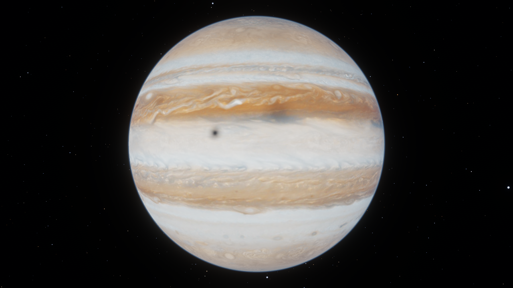

# Astronauta Cósmico 🧑‍🚀

Jogo em **Python + OpenGL 3.3 (core profile, pipeline programável com GLSL)**: você é um astronauta
com superpoderes que voa livremente pelo Sistema Solar — Sol, 8 planetas, a Lua, as 4 luas galileanas
de Júpiter, Titã, os anéis de Saturno e o cinturão de asteroides.



A documentação técnica (iluminação, sombreamento, sombras, texturas, modelagem e perguntas de
avaliação) está em **[DOCUMENTACAO.md](DOCUMENTACAO.md)**.

## Instalação

Requer Python 3.10+ e uma GPU com OpenGL 3.3.

```bash
python -m venv .venv
```

```bash
.venv\Scripts\activate
```

```bash
pip install -r requirements.txt
```

```bash
python main.py
```

Na **primeira execução** as texturas procedurais são geradas em numpy (~1 minuto) e salvas em
`assets/textures/generated/`; nas próximas o jogo abre em poucos segundos.

**Texturas fotográficas reais** (já incluídas em `assets/textures/`) são usadas automaticamente.
Para baixá-las de novo (ex.: em outra máquina):

```bash
python tools/baixar_texturas.py
```

Para comparar com as texturas 100% procedurais geradas pelo código:

```bash
python main.py --procedural
```

> Créditos das texturas fotográficas: **Solar System Scope (INOVE), CC BY 4.0** —
> https://www.solarsystemscope.com/textures/ . As luas Io, Europa, Ganimedes, Calisto e Titã,
> o traje do astronauta e os normal maps de Lua/Mercúrio/Marte continuam procedurais.

## Falas do astronauta

Ao chegar perto de cada planeta o astronauta fala pelo rádio do capacete (com legenda):
*"Eu me autoproclamo presidente de Marte."* — na Terra, *"...presidente do Brasil."* — e perto do Sol:
*"Meu Deus, cheguei no Ceará, foi?"*. A voz é sintetizada uma única vez com a voz pt-BR do Windows
("Microsoft Daniel") e fica em cache em `assets/speech/`. Para mudar as frases, edite `PHRASES` em
`astro/speech.py` (o cache é refeito automaticamente).

## Controles

| Tecla | Ação |
|---|---|
| Mouse | olhar / guiar o voo (clique na janela para capturar; ESC solta) |
| W / S, A / D | frente / trás, laterais |
| Espaço / Ctrl | subir / descer |
| Q / E | girar (roll) |
| Shift | turbo (×6) |
| Roda do mouse | multiplicador de velocidade (0,1× a 8×). A velocidade **se ajusta sozinha à altitude**: lenta perto das superfícies, enorme no vazio — Terra → Júpiter em ~8 s (2 s com Shift) |
| 0 – 9 | piloto automático: 0 Sol, 1 Mercúrio, 2 Vênus, 3 Terra, 4 Marte, 5 Júpiter, 6 Saturno, 7 Urano, 8 Netuno, 9 Lua |
| Tab / Enter | escolher qualquer corpo (inclui Io, Europa, Ganimedes, Calisto, Titã) / viajar |
| Botão direito + arrastar | orbitar a câmera em volta do astronauta (V reseta) |
| C | 1ª / 3ª pessoa · Z / X: aproximar / afastar a câmera |
| L | lanterna do capacete (luz spot) |
| [ / ] , P | desacelerar / acelerar o tempo, pausar |
| R / O | rótulos / linhas das órbitas |
| M | som liga/desliga |
| H | ajuda na tela |
| F1 | HUD |
| **F2** | **Phong → Gouraud → Flat** |
| F3 / F4 / F5 | normal mapping / sombras / texturas |
| F6 / F7 / F8 / F9 | atmosferas / bloom / wireframe / tone mapping |
| F12 | captura de tela (`screenshots/`) |

## Opções de linha de comando

```bash
python main.py --goto saturn --dist 5 --angle 150
```

`--goto` corpo inicial · `--dist` distância em raios · `--angle` ângulo em relação ao Sol ·
`--elev` elevação · `--time` dia inicial · `--fp` primeira pessoa · `--fullscreen` ·
`--shading 0|1|2` · `--mute` · `--procedural` (ignora texturas reais) · `--quality 0.5` (texturas menores) ·
`--shot arquivo.png` (renderiza sem janela e salva a imagem).

## Estrutura

```
main.py                 ponto de entrada (argumentos)
astro/app.py            janela, entrada, simulação e pipeline de renderização
astro/solar_system.py   dados físicos reais e mecânica orbital
astro/astronaut.py      modelo hierárquico, animação e controle de voo
astro/mesh.py           geração de malhas (esfera UV, cápsula, superelipsoide, icosfera, anel)
astro/procedural.py     texturas procedurais (ruído 3D, fBm, crateras, bandas...)
astro/texture.py        upload de texturas (mipmaps, anisotrópico, sRGB)
astro/shader.py         compilação de GLSL com #include
astro/hud.py            texto 2D com atlas de glifos
astro/audio.py          síntese de áudio procedural em tempo real (sounddevice)
astro/speech.py         falas do astronauta (TTS do Windows + efeito de rádio + legendas)
shaders/*.vert|frag     todos os shaders GLSL 330
tools/baixar_texturas.py
```
